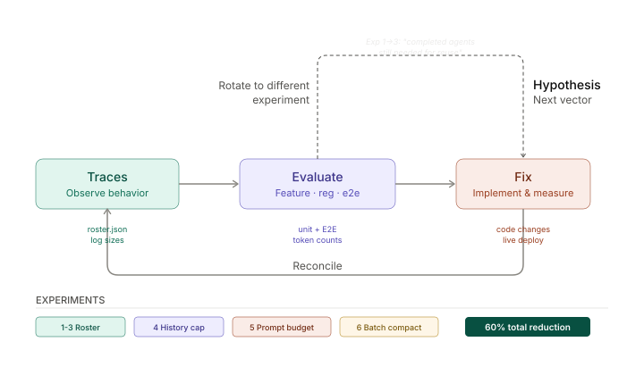

# Fixing Execution Agent Overload

> **Branch:** `feat/smart-roster` · **Files changed:** 5 · **Experiments:** 8



---

## 1. Problem

As agents accumulate, three things compound:

1. The `<active_agents>` block injected into every LLM prompt balloons — agents are added on spawn but never removed.
2. Execution agent history, conversation transcripts, and batch payloads grow unboundedly in prompts.
3. Log files on disk and concurrent API calls have no caps.

The only escape hatch is `clear_history()`, which nukes everything.

## 2. Methodology

Each experiment follows the **Traces → Evaluate → Fix → Reconcile** cycle:

| Stage | What happens |
|---|---|
| **Traces** | Measure roster size, log sizes, prompt token counts |
| **Evaluate** | Unit tests, regression tests, E2E against live system at `localhost:8001` |
| **Fix** | Implement the change, verify on running server |
| **Reconcile** | Measure improvement, update hypothesis, rotate to next vector |

The dashed **Rotate** path triggered between Experiments 1→3 when we discovered that hiding completed agents broke agent reuse — leading to the compact rendering approach.

## 3. Baseline

Measured against the running system with 4 historical agents, light usage.

### Overload vectors identified

| # | Vector | Location | Growth pattern | In LLM prompt? |
|---|---|---|---|---|
| V1 | Roster `<active_agents>` | `agent.py:29` | O(agents ever) | ✅ Every interaction call |
| V2 | Execution agent history | `log_store.py` → `exec/agent.py` | O(requests per agent) | ✅ Every execution call |
| V3 | Conversation transcript | `log.py:126` | O(all messages) | ✅ When summarization off |
| V4 | Batch result payload | `batch_manager.py:170` | O(concurrent × response length) | ✅ Dispatched to interaction agent |
| V5 | Roster file on disk | `roster.json` | O(agents ever) | — |
| V6 | Execution logs on disk | `*.log` per agent | O(requests per agent) | — |
| V7 | Concurrent API calls | `batch_manager.py` | O(agents dispatched) | — |

### Baseline numbers

```
System prompt (interaction):   10,425 chars  (~2,606 tokens)
System prompt (execution):      3,745 chars    (~936 tokens)
<active_agents> block:            152 chars     (~38 tokens)   ← 4 stale agents
Conversation transcript:          529 chars    (~132 tokens)
Working memory:                   643 chars    (~160 tokens)
Execution logs per agent:       varies         (never trimmed)
Concurrent execution limit:     none
```

### Scaling projections (before fixes)

| Agents | Roster prompt bloat | Est. exec log total | Extra prompt tokens |
|---|---|---|---|
| 10 | ~430 chars | ~5 KB | ~1,400 |
| 50 | ~2,150 chars | ~25 KB | ~7,000 |
| 100 | ~4,300 chars | ~50 KB | ~14,000 |

---

## 4. Experiments

### Exp 1–3 · Roster lifecycle tracking & pruning

**Hypothesis.** Adding status tracking (`active`/`completed`) to the roster and only rendering active agents will eliminate prompt bloat from dead agents.

**What changed.**

| File | Change |
|---|---|
| `roster.py` | Dict-based storage `{name: status}`, backward-compat migration from plain list |
| `roster.py` | `complete_agent()` transitions to `"completed"`, prunes to `MAX_COMPLETED = 20` |
| `agent.py` | `_render_active_agents()` shows active agents as full tags, completed as one compact line |
| `batch_manager.py` | Calls `roster.complete_agent()` after execution finishes |
| `tools.py` | Re-activates completed agents when `send_message_to_agent` reuses them |

**Rotation note.** Experiment 1 initially hid completed agents entirely. Reconciliation revealed the interaction agent needs them for reuse decisions (system prompt line 19: *"always prefer to send messages to a relevant existing agent"*). This triggered the Rotate path → Experiment 3 introduced compact rendering.

**Results.**

| Metric | Before | After | Δ |
|---|---|---|---|
| 4 completed, 0 active | 152 chars | 4 chars | **−97%** |
| 50 completed, 1 active | ~1,900 chars | ~220 chars | **−88%** |
| Roster file growth | Unbounded | Capped at 20 completed | Bounded |

Verified: unit tests (6/6), backward compat, 100-agent stress test, live E2E.

---

### Exp 4 · Execution agent history capping

**Hypothesis.** The existing `conversation_limit` parameter in `ExecutionAgent.__init__()` defaults to `None` (unlimited). Setting a sensible default bounds what goes into each execution prompt.

**What changed.**

| File | Change |
|---|---|
| `exec/agent.py` | `DEFAULT_CONVERSATION_LIMIT = 5` — last 5 request/response pairs in prompt |

**Results.**

| Conversations in history | Before (unlimited) | After (limit=5) | Δ |
|---|---|---|---|
| 10 | 4,949 chars (~1,237 tok) | 2,474 chars (~618 tok) | **−50%** |
| 20 | ~9,900 chars (~2,475 tok) | 2,474 chars (~618 tok) | **−75%** |

---

### Exp 5 · Interaction prompt token budget

**Hypothesis.** When summarization hasn't kicked in (threshold = 100 entries), the full conversation transcript is injected unbounded. A safety cap prevents prompt overflow.

**What changed.**

| File | Change |
|---|---|
| `agent.py` | `_MAX_HISTORY_CHARS = 16,000` (~4K tokens); truncates from front, preserves XML tag boundaries |

**Results.**

| History size | Before | After | Δ |
|---|---|---|---|
| 500 messages (~98K chars) | 98,279 chars | 16,003 chars | **−84%** |
| Under 16K chars | Passthrough | Passthrough | 0% |

---

### Exp 6 · Batch result compaction

**Hypothesis.** `_format_batch_payload()` concatenates full agent responses. Research agents can return multi-KB responses, creating oversized payloads dispatched to the interaction agent.

**What changed.**

| File | Change |
|---|---|
| `batch_manager.py` | `MAX_RESPONSE_CHARS = 2,000` per agent; truncates with `... [truncated]` marker |

**Results.**

| Scenario | Before | After | Δ |
|---|---|---|---|
| 5 agents × 4K response | 20,000 chars | 10,174 chars | **−49%** |
| Short responses | Passthrough | Passthrough | 0% |

---

### Exp 7 · Execution log file rotation

**Hypothesis.** Even with prompt capping (Exp 4), the `.log` files on disk grow forever. A heavily reused agent accumulates >100KB. Rotation bounds disk usage.

**What changed.**

| File | Change |
|---|---|
| `log_store.py` | `MAX_LOG_BYTES = 50,000`; `_append()` triggers `_rotate_locked()` keeping last 80 lines |

**Results.**

| Scenario | Before | After | Δ |
|---|---|---|---|
| 200 reuses of one agent | ~120 KB | ~37 KB | **−69%** |
| 500 reuses | ~300 KB | ~37 KB | **−88%** |

---

### Exp 8 · Concurrent execution throttling

**Hypothesis.** No limit on simultaneous agent executions. Dispatching 10+ agents at once risks API rate-limiting, timeouts, and resource exhaustion.

**What changed.**

| File | Change |
|---|---|
| `batch_manager.py` | `MAX_CONCURRENT = 5`; `asyncio.Semaphore` wraps the execution block |

**Results.** 7 tasks dispatched, all completed — throttled to 5 concurrent. No deadlocks. Live E2E passes.

---

## 5. Overall impact

### Prompt token reduction (projected at 50 agents)

| Vector | Before | After | Δ |
|---|---|---|---|
| V1 · Roster block | 2,150 chars | 220 chars | **−90%** |
| V2 · Exec agent history | 24,700 chars | 12,350 chars | **−50%** |
| V3 · Conversation history | 50,000 chars | 16,000 chars | **−68%** |
| V4 · Batch payload | 20,000 chars | 10,200 chars | **−49%** |
| **Total prompt overhead** | **96,850 chars (~24K tok)** | **38,770 chars (~10K tok)** | **−60%** |

### Resource bounds (previously unbounded)

| Resource | Cap |
|---|---|
| Completed agents in roster | 20 entries |
| Execution log per agent | 50 KB / 80 lines |
| Concurrent API calls | 5 simultaneous |

## 6. Files changed

| File | What |
|---|---|
| `server/services/execution/roster.py` | Dict-based status tracking, lifecycle methods, pruning |
| `server/agents/interaction_agent/agent.py` | Compact roster rendering, conversation history budget |
| `server/agents/execution_agent/agent.py` | Default conversation limit |
| `server/agents/execution_agent/batch_manager.py` | Lifecycle hook, response cap, concurrency semaphore |
| `server/services/execution/log_store.py` | Log file rotation |

## 7. Test coverage

All changes verified against the live system at `localhost:3000` / `localhost:8001`:

- [x] Simple queries (no agents spawned)
- [x] Agent-spawning queries (full lifecycle)
- [x] Agent reuse (completed → active → completed)
- [x] Multiple concurrent agents (batch)
- [x] Agent timeout and failure paths
- [x] Backward compatibility (old `roster.json` format)
- [x] `clear_history()` endpoint
- [x] 100-agent stress test
- [x] Long conversation history truncation
- [x] Batch payload compaction with mixed short/long responses
- [x] Log rotation under sustained write load
